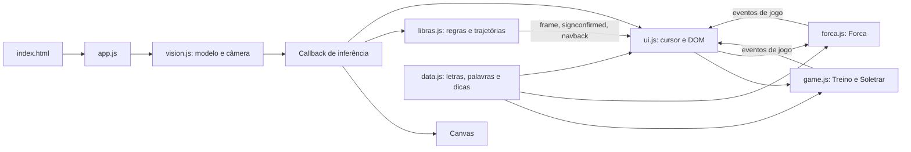

# Sistema implementado

**Última inspeção:** 24/10/2026. **Referência:** FASE 03.3B-1.2 no worktree `feat/fase-03-cooldown`, sem integração automática.

## Unidade executável e dependências

Aplicação estática iniciada por `index.html` → `js/app.js`. Oito módulos ES, um CSS e HTML, sem pacote/build/servidor de aplicação. O browser carrega `@mediapipe/tasks-vision@0.10.14` de jsDelivr, runtime WASM e modelo `hand_landmarker/float16/1` do Google Storage. Fontes Rajdhani e Share Tech Mono vêm de Google Fonts. Não há código Python nem TypeScript versionado.

As setas do diagrama representam fluxo/responsabilidade, não apenas imports. No grafo de imports, `data.js → libras.js → vision.js → CDN`: a leitura dos dados também carrega a dependência de visão. `libras.js` depende dos índices `LM` e da função `splitHandsByRole()` definidos em visão. Não há isolamento de infraestrutura suficiente para importar os motores diretamente no Node sem substituir essa fronteira.

## Inicialização e ciclo de frame

1. O navegador resolve módulos/fontes; o clique em Começar chama `boot()`.
2. `loadModel()` resolve WASM e cria `HandLandmarker` em VIDEO, GPU, uma mão e thresholds de detecção/presença/tracking de 0,5.
3. `startCamera()` pede vídeo sem áudio, ideal 320×240, máximo 480×360 e até 30 FPS; associa `srcObject`, espera dados (até 10 s) e aguarda `play()`. São constraints solicitadas, não medições da resolução entregue.
4. O app cria `LibrasEngine`, `Game`, `ForcaGame` e `UI` uma vez e inicia rAF. A UI cadastra listeners e monta guia apenas nessa criação.
5. Se o vídeo está pronto, o frame mudou e passaram 50 ms, chama `detectForVideo()`, conta inferências concluídas na janela de 1 s e executa o callback. Mede separadamente inferência e consumidor; média/p95/máximo são calculados ao consultar `getPerformanceMetrics()`. Uma geração do loop impede cadeias simultâneas e reagendamento após parada; reinício zera estatísticas. Falha de detector/consumidor encerra o loop e mostra a tela de erro.
6. O callback desenha Canvas 640×480, atualiza reconhecimento e chama diretamente `UI._onCursorFrame()`. Limpa no desaparecimento da mão; vazio repetido não exige nova limpeza. Resize só redefine bitmap quando as dimensões mudam. Landmarks/cursor são espelhados em X; não há compensação do recorte `object-fit: cover`.

## Reconhecimento e comunicação

Features usam distâncias 3D e ângulos 2D da imagem; escala mínima de `1e-4`. As 24 regras estáticas produzem média de escores fuzzy. O melhor escore ≥0,55 alimenta hold de 600 ms; perda breve tem graça de 250 ms. Não há margem de separação entre candidatos ou calibração probabilística. Esses parâmetros e regras não foram alterados na FASE 03.

Na 03.3B-2A, V mantém a média de seis componentes de forma e aplica um desconto de até 0,20 ao escore somente quando a direção projetada é descendente e o polegar está próximo da região entre indicador/médio. K e P mantêm as regras anteriores. A/O continuam com possibilidade de empate em 1,00. O desconto é uma hipótese validada em fixtures, sem calibração de webcam. Não depende da letra alvo nem da mão física declarada.

A confirmação usa `performance.now()` recebido pelo motor e cinco fases em `state.recognitionPhase`: `READY` aceita candidato; `STABILIZING` acumula hold estático e trajetória J/Z; `CONFIRMED` marca o frame da emissão única de `signconfirmed`; `COOLDOWN` bloqueia novas confirmações por no mínimo 900 ms; `WAIT_RELEASE` espera liberação ou mudança estável. O rearmamento estático exige ausência contínua de candidata por 250 ms para repetir a letra, ou outra candidata contínua por 300 ms para trocar sem retirar a mão. A liberação e a intenção dinâmica podem ser observadas durante o cooldown, mas nenhuma nova confirmação é emitida antes do prazo; o novo hold estático só começa depois dele. Candidatos e trajetórias anteriores são descartados na confirmação e no rearmamento; `resetTracking()` limpa também a fase temporal na pausa/troca de tela. `resetHold()` limpa apenas o hold, preservando o cooldown quando um jogo avança de alvo.

Durante `COOLDOWN`/`WAIT_RELEASE`, a classificação estática continua para detectar transições e alimentar o painel. Desde a FASE 03.1, o motor também observa trajetórias novas, mas descarta as que terminam antes de 900 ms; uma trajetória válida concluída depois do prazo pode rearmar D→Z ou I→J sem retirar a mão. Movimento em curso não conta como liberação nem como mudança estática. O loop de inferência, Canvas, cursor e `navback` continuam ativos. A UI usa o elemento existente `hint-text` para mostrar fase apenas quando ela muda, mantendo o anel sem progresso confirmável durante a espera. O relógio do Soletrar continua nesse intervalo; revisão de sua duração ficou para a FASE 04.

J/Z acumulam posições de ponta normalizadas pela escala da mão. Janela 1.300 ms, suavização de 3 pontos, ao menos 6 amostras. J usa curvatura/mudança angular; Z conta inversões horizontais. O comprimento acumulado da trajetória sozinho já não suspende D/I: a intenção requer deslocamento **líquido recente** de 0,06 em até 400 ms, após pelo menos 3 amostras. A suspensão tolera 300 ms sem continuação; depois o trajeto incompleto é descartado e o hold estático pode reiniciar. Amostras estacionárias anteriores ao movimento são substituídas dentro de raio 0,03, impedindo que deformem o desenho. Uma falha de landmarks de até 300 ms pode preservar a trajetória incompleta; falha maior, pausa e troca de sessão a limpam. Após confirmar J/Z, I/D é pose residual e não rearma a letra estática; outra trajetória da mesma pose requer 250 ms de ponta estável dentro de raio 0,04 ou uma liberação/rearmamento alternativo. Essas grandezas são hipóteses de software ainda não calibradas com sinais reais. O gesto de voltar acompanha o pulso numa janela de 700 ms, com cooldown independente de 1.200 ms. `resetHold()` ainda limpa só a sustentação estática; `resetTracking()` limpa todos os buffers de reconhecimento.

Na FASE 03.1.2, priorizar movimento também requer avanço vertical recente de 0,04. Z exige três traços alternados com extensão horizontal mínima de 0,08 cada, avanço vertical de 0,04 no traço central, separação vertical total de 0,10, consistência vertical de 0,75 e duração mínima de 300 ms. J exige avanço vertical líquido de 0,10 e consistência de 0,65 além dos critérios de curva anteriores. Duas inversões sem progressão coerente rejeitam o caminho, deixam o hold de D/I prosseguir e bloqueiam nova trajetória da mesma pose até uma pausa da ponta por 250 ms dentro de raio 0,04 ou troca de pose-base. Os escores de I/Y não mudaram: Y compartilha os quatro componentes de I e acrescenta o polegar; uma candidata I visível num frame não garante 600 ms contínuos, nem prova que `signconfirmed` foi emitido. Os novos limiares são hipóteses sintéticas, não precisão medida. [Decisão detalhada](changes/2026-10-23-fase-0312-z-i-treino.md).

Na FASE 03.3B-1, J também exige no trajeto suavizado um segmento de três passos descendentes consecutivos, cada um com deriva lateral no máximo 0,25 da descida. A busca percorre o buffer limitado existente; não exige que as primeiras amostras já sejam de movimento. Um intervalo sem callback superior à graça existente de 300 ms descarta a trajetória antes de processar uma pose-base retomada. Não mudaram o hold, o cooldown, a regra estática I/Y nem Z. Uma haste curta ou muito inclinada pode ser rejeitada; os limiares não foram validados com webcam. A e O podem pontuar ambos 1,00, e a ordem de `RULES` entrega A em empate; nenhuma regra O/A foi alterada. [Diagnóstico e decisão](changes/2026-10-24-fase-033b1-j-oa.md).

Na FASE 03.3B-1.2, três passos de haste continuam necessários, mas a trajetória J também precisa atingir um ponto inferior e retornar ao menos 0,03 na vertical e 0,06 lateralmente depois dele. Isso rejeita a haste seguida só de desvio lateral reproduzida sinteticamente; os outros critérios de curva e consistência continuam. O percurso existente é analisado sem novo buffer ou timer. A condição pode perder um J real com retorno pouco visível. [Decisão da fase](changes/2026-10-24-fase-033b12-j-calibracao.md).

Na FASE 03.3B-1.3, J deixou de exigir três passos consecutivos. A trajetória suavizada é dividida no ponto de maior coordenada vertical: a haste deve ter descida líquida ≥0,26, maior que seu desvio lateral, e consistência ≥0,65; o gancho posterior mantém subida ≥0,03 e lado ≥0,06. Curva, razão percurso/reta, avanço líquido, número mínimo de amostras e janela temporal seguem obrigatórios. Durante perda breve da pose-base I, só um J já em andamento recebe novos pontos por até 300 ms; salto do pulso acima de 0,26 da escala inicial descarta o trajeto. Para J, as coordenadas somam deslocamento do pulso na escala inicial e posição da ponta relativa ao pulso na escala corrente, compensando zoom sem apagar movimento global. Z usa a normalização anterior. Sem identidade persistente da mão no MediaPipe atual, continuidade espacial não garante identidade física. [Decisão da fase](changes/2026-10-24-fase-033b13-j-segmentacao.md).

| Emissor | Eventos e consumidores |
| --- | --- |
| `LibrasEngine` | `frame` contém referência mutável a `state`; `signconfirmed` traz `{ letter }`; `navback` solicita navegação. UI consome todos. |
| `Game` | `start`, `newtarget`, `correct`, `wrong`, `wordcomplete`, `levelup`, `timeout`, `tick`, `sessionend`; UI renderiza alvo, relógio e placar. |
| `ForcaGame` | `start`, `newword`, `hit`, `miss`, `repeated`, `win`, `lose`, `levelup`, `sessionend`; UI renderiza palavra/forca/placar. |

`signconfirmed` só é encaminhado ao jogo quando `currentScreen` é `play` ou `forca-play`. Abertura de guia não muda esse campo. O app entrega o cursor por chamada direta; o listener legado `libras-cursor` foi removido. UI também usa `_snapshot()` dos jogos.

### Instrumentação da FASE 03.2

`diagnostics.js` possui uma instância local inicialmente desligada. `app.js` expõe apenas `enable()`, `disable()`, `clear()` e `read()` em `window.librasArcadeDiagnostics`. Não cria timers nem listeners. Quando ativa, verifica comprimento de 21 landmarks e coordenadas `x/y` finitas antes do desenho; um resultado inválido produz `input_invalid` e um frame seguro sem mão. Não registra nem envia os pontos, imagens, vídeo ou o objeto de features. A lista permitida de campos aceita somente escalares; a leitura devolve cópias.

O registro circular mantém no máximo **120 eventos**; uma observação `recognition` entra a cada **200 ms** ou mudança de candidata, fase ou razão. A classificação calcula o segundo melhor escore somente com captura ligada. A UI serializa os oito eventos mais recentes no painel a cada 200 ms quando ele está aberto. `mode`/`screen` vêm da navegação, sem consulta DOM por frame. `disable()` apaga os eventos. CPU/RAM reais não foram medidos; com diagnóstico desligado, não há validação estrutural extra, cálculo da segunda candidata nem serialização do painel.

`recognition` descreve presença/validade da mão, primeira e segunda candidatas estáticas, elegibilidade pelo limiar, escores e diferença (`gap`), `phase`, `stabilizingMs`, `cooldownRemainingMs`, `motionLetter`, amostras, progresso e `motionStatus`. `hold_reset` identifica troca/perda da candidata ou suspensão por movimento; `motion_rejected` identifica trajetória incompleta ou incoerente. `signconfirmed` é registrado imediatamente antes da emissão síncrona do evento. A UI registra `ui_received`, depois `game_decision` com `expected`, índice, rodada e razão devolvida pelo motor; `ui_target` comprova passagem pelo renderizador. `round_start`, `game_timeout`, `screen_change`, `tracking_reset`, `app_pause` e `app_resume` ajudam a localizar trocas de sessão. O escore não é probabilidade; `gap = 0` mostra empate, sem impor limiar de margem. `below_threshold` refere-se a `MIN_SCORE = 0,55`, enquanto `cooldown`, `wait_release`, `residual_base` e `motion_in_progress` explicam bloqueios temporais. Nenhuma confirmação é reenviada pelo diagnóstico.

A calibração da 03.3B-1.2 exige `startCalibration()` com intenção, mão física, orientação, distância e espelhamento informados pelo avaliador. Cada início limpa o anel e rotula uma tentativa; `stopCalibration()` para a captura e deixa a leitura em memória, enquanto `disable()` apaga. Somente nessa modalidade, `recognition` recebe features geométricas escalares e escores de regras concorrentes já calculados em `classify()`. `motion_geometry` amostra métricas escalares de J com 200 ms de espaçamento ou no instante de validação do trajeto. `signconfirmed.elapsedMs` conta desde o início manual. Não há handedness inferido, exportação automática ou persistência de dados biométricos; o anel segue limitado a 120 eventos. A captura pode deslocar eventos mais antigos do anel durante uma tentativa longa. Seu custo real não foi medido.

Na 03.3B-2A, essa captura inclui `scoreS`/`scoreE` já avaliados no loop de regras e quatro escalares adicionais calculados só com calibração ativa: `palmProjectedArea`, `palmDepthSpan`, `fingerAngleIM` e `tipClusterIMR`. São projeções e distâncias normalizadas; não inferem mão física ou orientação real da palma. Desligada a captura, esses quatro cálculos não ocorrem. O limite de 120 eventos, a amostragem e a política de descarte permanecem.

Na 03.3B-1.3, `motion_geometry.reason` identifica a primeira condição geométrica ou global que falhou (`intent_missing`, `samples_insufficient`, `path_short`, `stem_insufficient`, `stem_inclined`, `stem_incoherent`, `hook_absent`, `hook_rise_short`, `hook_lateral_short`, `turn_insufficient`, `curviness_insufficient`, `vertical_progress_insufficient`, `vertical_consistency_insufficient`) ou `accepted`. As métricas de haste observada não são zeradas quando a regra a rejeita. A perda da pose-base é `motion_base_lost`; descarte por tempo ou salto espacial é `motion_rejected` com `stale_history` ou `tracking_discontinuity`. Amostras são limitadas a 200 ms ou mudança de motivo; diagnóstico desligado não cria objetos de métricas nem registros adicionais. Não se infere resultado final de uma tentativa apenas por uma amostra intermediária.

`Game.handleSign()` mantém os mesmos eventos e agora devolve `accepted`, `wrong_letter`, `no_session`, `paused` ou `round_transition`; este último ocorre no atraso de 450 ms após palavra completa ou timeout. `ForcaGame.handleGuess()` devolve também `repeated_letter`. A UI rejeita `signconfirmed` fora das telas de jogo com `inactive_screen`. No Soletrar, `wordcomplete` passou a chamar `_renderTarget()` para marcar a última letra concluída antes da próxima palavra; o caractere final continua sendo a referência esquemática durante o atraso. O cronômetro por letra segue ativo durante cooldown, sem mudança de duração.

## Estado, pontuação e transições

`Game.mode` é `null`, `practice` ou `word`. Nos níveis tradicionais, Treino usa fila embaralhada filtrada pela dificuldade; Soletrar escolhe o banco do nível. O conjunto especial `practiceSet = 'all'` usa `LETTER_POOL` ordenado de A a Z, inclui J/Z, mantém tempo de nível 1 e não sobe de nível. Cada acerto dá `round(10 × (1 + min(4, floor(streak/3)) × 0.25))`; palavra completa acrescenta `20 + 5 × tamanho`. Nos modos tradicionais, a cada 5 letras corretas sobe o nível até 5 e esvazia a fila.

O tempo por letra é `max(6000, 12000 - (nível - 1) × 700)` ms, com 2.500 ms extras no Soletrar. Um intervalo subtrai 100 ms por callback. Erro zera sequência sem trocar imediatamente o alvo; timeout zera sequência e agenda outro alvo/palavra. Acerto no Treino e palavra completa agendam avanço de 450 ms. `bestStreak` zera em cada `startPractice()`/`startWord()` e representa apenas a sessão corrente. `pause()` congela intervalo e avanço pendente; `end()` cancela ambos, tenta salvar o recorde, emite `sessionend` e põe `mode = null` mesmo se o armazenamento falhar.

`Game.navigatePracticeTarget(destination)` é a operação manual única do Treino ativo e não pausado: `+1` avança, `-1` retorna e uma letra nominal seleciona diretamente dentro do conjunto atual. Em A–Z, a navegação é circular; `practicePosition`/`practiceCount` alimentam o rótulo “8 de 26”. Nos níveis, Próxima preserva o sorteio existente e Anterior percorre um histórico limitado a 52 alvos, sem sortear ao voltar. No primeiro alvo, Anterior permanece visível e desabilitado. A seleção direta respeita `LETTERS[letter].difficulty <= level`, inclusive após subida automática. A operação cancela o avanço pendente, reinicia o cronômetro e emite `newtarget`, sem pontuar ou alterar sequência/recorde. `skipPracticeTarget()` delega a `+1`; acerto e timeout mantêm avanço automático. `UI` distingue visualmente **Todas as letras** de **Treino por nível**, usa `aria-pressed` nos botões selecionáveis e oferece início explícito do nível. Anterior, Próxima e Escolher letra aparecem apenas em Treino ativo; o seletor é reconstruído somente quando conjunto ou nível mudam. Após troca manual válida, a UI chama `resetTracking()` para limpar cooldown, candidato e trajetória anteriores. Listeners são registrados uma vez; não há temporizador por frame. O menu e o jogo permitem rolagem quando não cabem na altura disponível.

`ForcaGame.status` passa entre `idle`, `playing`, `won`, `lost`. Um `Set` evita repetir palpite. Cada ocorrência correta dá 10 pontos; vitória acrescenta `max(10, 30 + tamanho × 5 - erros × 5)`. Seis erros encerram a rodada; vitória/derrota agendam palavra nova em 1.600 ms, com atraso conservado na pausa. Três vitórias sobem um nível até 5; `wins` zera em cada `start()`. `end()` cancela o avanço, tenta salvar o recorde, emite `sessionend` e define `idle` mesmo se o armazenamento falhar.

Não há término automático da sessão por número de rodadas. A saída manual da UI usa `_exitingManually` para suprimir resultados e retornar ao menu. Essa navegação não encerra webcam/inferência.

## Persistência e recursos

- `localStorage`: `libras-arcade:best-score` compartilhado por Treino/Soletrar e `libras-arcade:best-score-forca`. Leitura/escrita com tratamento de exceção e aviso no console. Cada motor conserva o maior recorde em memória, compara com o valor persistido antes de escrever e tenta novamente no próximo ponto normal de persistência: fim de sessão em Treino/Soletrar; vitória ou fim na Forca. Enquanto a leitura falhar, não grava para evitar sobrescrever um recorde persistido maior. Memória não sobrevive a recarga da página.
- Nome do jogador: atualização de texto do HUD; sem cadastro, histórico ou ranking persistente implementado.
- Câmera: `vision.js` possui o stream, interrompe todas as tracks e retira `srcObject` na pausa/erro/`pagehide`. A câmera permanece ativa ao sair da rodada para permitir gestos no menu.
- Modelo: referência de módulo compartilhada entre tentativas e fechada em `pagehide`; carregamento tardio após descarte é invalidado. rAF: uma cadeia em `vision.js`, parada ao ocultar a aba ou diante de erro; callbacks antigos não a rearmam.
- Telemetria: quatro `Float64Array(120)` para timestamps e tempos, 3.840 bytes de armazenamento numérico fixo. FPS usa janela de 1 s; durações usam até 120 amostras, inclusive enquanto parado. Contadores acumulam desde o último início. Históricos de movimento/navegação mantêm suas janelas; não são datasets persistidos.
- Timers: intervalo de Treino/Soletrar e avanços dos três modos são guardados, pausados e cancelados no encerramento; toast cancela timeout anterior.
- UI: uma instância registra listeners persistentes durante a página; sem `dispose()`. Há caches parciais de valores. O painel de diagnóstico só serializa quando aberto e limitado a cada 200 ms; outras atualizações visuais ainda podem ocorrer por frame ou tick.

## Lacunas

Há testes focados e baseline controlada de desempenho da FASE 01 e testes sintéticos do ciclo de recursos da FASE 02; não há protocolo de precisão, matriz de navegadores ou CI. Métricas dentro do callback podem conter a amostra atual ainda sem duração do consumidor; consultar após seu retorno para tempos finalizados. O HUD atualiza apenas quando recebe resultados. O import remoto ocorre antes do tratamento de erro do app; recuperação e desempenho com webcam real ainda exigem validação. O [roadmap](../docs/ROADMAP.md) é a fonte dos achados e prioridades; [decisões abertas](open-decisions.md) contém os contratos ainda por resolver.
