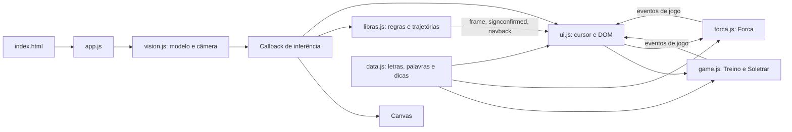

# Sistema implementado

**Última inspeção:** 20/10/2026. **Referência:** `9063154f5661c50fc7312059aa769709615b3e70`, com documentação da FASE 00 e alterações locais de performance da FASE 01, sem commit.

## Unidade executável e dependências

Aplicação estática iniciada por `index.html` → `js/app.js`. Sete módulos ES, um CSS e HTML, sem pacote/build/servidor de aplicação. O browser carrega `@mediapipe/tasks-vision@0.10.14` de jsDelivr, runtime WASM e modelo `hand_landmarker/float16/1` do Google Storage. Fontes Rajdhani e Share Tech Mono vêm de Google Fonts. Não há código Python nem TypeScript versionado.

As setas do diagrama representam fluxo/responsabilidade, não apenas imports. No grafo de imports, `data.js → libras.js → vision.js → CDN`: a leitura dos dados também carrega a dependência de visão. `libras.js` depende dos índices `LM` e da função `splitHandsByRole()` definidos em visão. Não há isolamento de infraestrutura suficiente para importar os motores diretamente no Node sem substituir essa fronteira.

## Inicialização e ciclo de frame

1. O navegador resolve módulos/fontes; o clique em Começar chama `boot()`.
2. `loadModel()` resolve WASM e cria `HandLandmarker` em VIDEO, GPU, uma mão e thresholds de detecção/presença/tracking de 0,5.
3. `startCamera()` pede vídeo sem áudio, ideal 320×240, máximo 480×360 e até 30 FPS; associa `srcObject` e espera dados. São constraints solicitadas, não medições da resolução entregue.
4. O app cria `LibrasEngine`, `Game`, `ForcaGame` e `UI`, e inicia rAF. A UI cadastra listeners e monta guia.
5. Se o frame mudou e passaram 50 ms, chama `detectForVideo()`, conta inferências concluídas na janela de 1 s e executa o callback. Mede separadamente inferência e consumidor; média/p95/máximo são calculados ao consultar `getPerformanceMetrics()`. Uma geração do loop impede cadeias simultâneas e reagendamento após parada; reinício zera estatísticas.
6. O callback desenha Canvas 640×480, atualiza reconhecimento e chama diretamente `UI._onCursorFrame()`. Limpa no desaparecimento da mão; vazio repetido não exige nova limpeza. Resize só redefine bitmap quando as dimensões mudam. Landmarks/cursor são espelhados em X; não há compensação do recorte `object-fit: cover`.

## Reconhecimento e comunicação

Features usam distâncias 3D e ângulos 2D da imagem; escala mínima de `1e-4`. As 24 regras estáticas produzem média de escores fuzzy. O melhor escore ≥0,55 alimenta hold de 600 ms; perda breve tem graça de 250 ms. Não há margem de separação entre candidatos ou calibração probabilística.

J/Z acumulam posições de ponta normalizadas pela escala da mão. Janela 1.300 ms, suavização de 3 pontos, ao menos 6 amostras. J usa curvatura/mudança angular; Z conta inversões horizontais. O gesto de voltar acompanha o pulso numa janela de 700 ms, com cooldown de 1.200 ms. Ambos convivem com o reconhecimento estático. `resetHold()` não limpa os outros buffers.

| Emissor | Eventos e consumidores |
| --- | --- |
| `LibrasEngine` | `frame` contém referência mutável a `state`; `signconfirmed` traz `{ letter }`; `navback` solicita navegação. UI consome todos. |
| `Game` | `start`, `newtarget`, `correct`, `wrong`, `wordcomplete`, `levelup`, `timeout`, `tick`, `sessionend`; UI renderiza alvo, relógio e placar. |
| `ForcaGame` | `start`, `newword`, `hit`, `miss`, `repeated`, `win`, `lose`, `levelup`, `sessionend`; UI renderiza palavra/forca/placar. |

`signconfirmed` só é encaminhado ao jogo quando `currentScreen` é `play` ou `forca-play`. Abertura de guia não muda esse campo. O listener legado `libras-cursor` permanece registrado, mas o app usa chamada direta. UI também usa `_snapshot()` dos jogos.

## Estado, pontuação e transições

`Game.mode` é `null`, `practice` ou `word`. Partidas usam filas embaralhadas; Treino filtra letras pela dificuldade e Soletrar escolhe o banco do nível. Cada acerto dá `round(10 × (1 + min(4, floor(streak/3)) × 0.25))`; palavra completa acrescenta `20 + 5 × tamanho`. A cada 5 letras corretas sobe o nível até 5 e esvazia a fila.

O tempo por letra é `max(6000, 12000 - (nível - 1) × 700)` ms, com 2.500 ms extras no Soletrar. Um intervalo subtrai 100 ms por callback. Erro zera sequência sem trocar imediatamente o alvo; timeout zera sequência e agenda outro alvo/palavra. Acerto no Treino e palavra completa agendam avanço de 450 ms. `end()` cancela intervalo, salva recorde, emite `sessionend` e põe `mode = null`.

`ForcaGame.status` passa entre `idle`, `playing`, `won`, `lost`. Um `Set` evita repetir palpite. Cada ocorrência correta dá 10 pontos; vitória acrescenta `max(10, 30 + tamanho × 5 - erros × 5)`. Seis erros encerram a rodada; vitória/derrota agendam palavra nova em 1.600 ms. Três vitórias sobem um nível até 5. `end()` salva recorde, emite `sessionend` e define `idle`.

Não há término automático da sessão por número de rodadas. A saída manual da UI usa `_exitingManually` para suprimir resultados e retornar ao menu. Essa navegação não encerra webcam/inferência.

## Persistência e recursos

- `localStorage`: `libras-arcade:best-score` compartilhado por Treino/Soletrar e `libras-arcade:best-score-forca`. Sem proteção a erros de armazenamento.
- Nome do jogador: atualização de texto do HUD; sem cadastro, histórico ou ranking persistente implementado.
- Câmera: stream em `video.srcObject`, sem parada integrada das tracks.
- Modelo: referência de módulo, sem descarte explícito. rAF: uma cadeia em `vision.js`; início cancela anterior e parada invalida callbacks antigos, mas o app ainda não encerra o loop ao sair da rodada.
- Telemetria: quatro `Float64Array(120)` para timestamps e tempos, 3.840 bytes de armazenamento numérico fixo. FPS usa janela de 1 s; durações usam até 120 amostras, inclusive enquanto parado. Contadores acumulam desde o último início. Históricos de movimento/navegação mantêm suas janelas; não são datasets persistidos.
- Timers: intervalo do jogo é cancelado; timeouts de avanço não são guardados. Toast cancela timeout anterior.
- UI: listeners persistem durante a página; sem `dispose()`. Há caches parciais de valores, com atualizações/serialização remanescentes por frame.

## Lacunas

Há testes focados e baseline controlada de desempenho da FASE 01; não há protocolo de precisão, matriz de navegadores ou CI. Métricas dentro do callback podem conter a amostra atual ainda sem duração do consumidor; consultar após seu retorno para tempos finalizados. O HUD atualiza apenas quando recebe resultados. Exceções no detector/consumidor continuam sem recuperação; ciclo completo de câmera/modelo pertence à FASE 02. O [roadmap](../docs/ROADMAP.md) é a fonte dos achados e prioridades; [decisões abertas](open-decisions.md) contém os contratos ainda por resolver.
